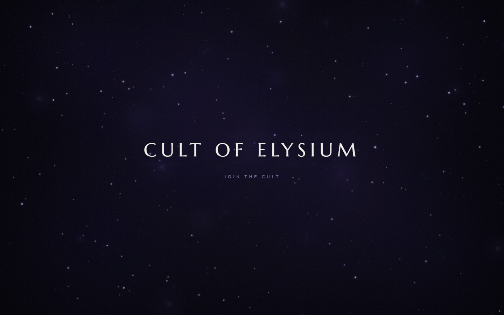
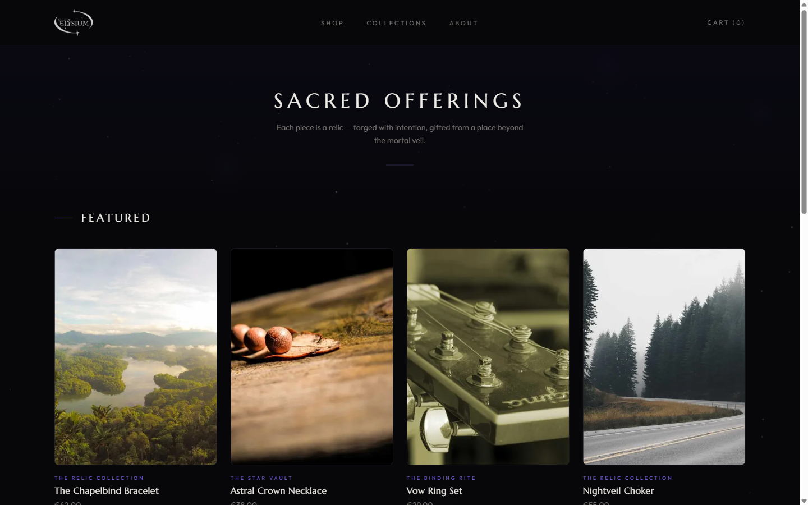
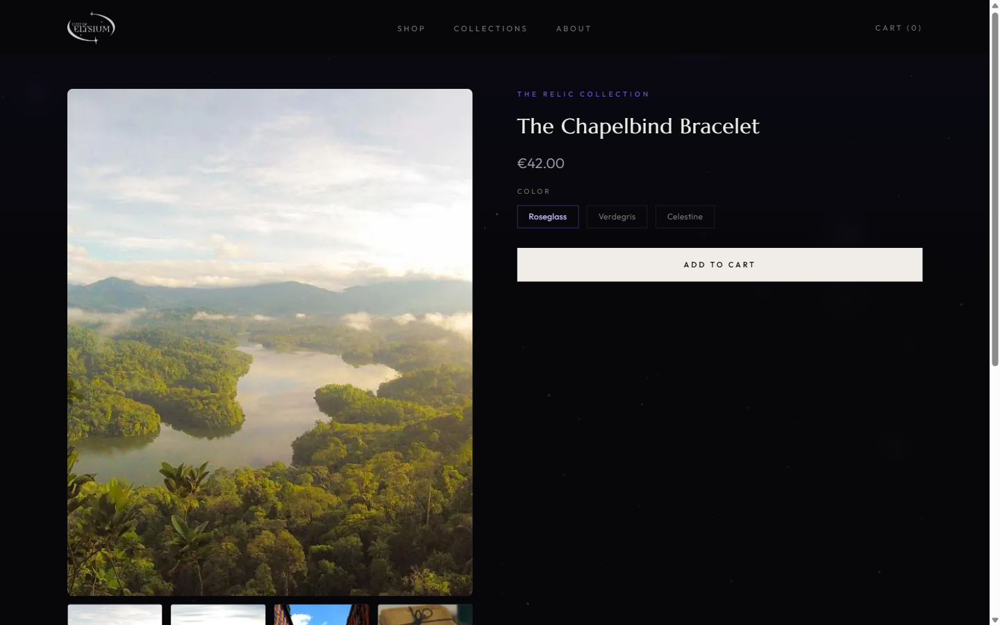

# Cult of Elysium

A headless e-commerce storefront for a gothic jewelry brand, built with **Next.js 16 (App Router)**, **React 19** and the **Shopify Storefront API**.

<!-- Add your deployed URL here once it's live, e.g.: **[Live demo →](https://cult-of-elysium.vercel.app)** -->



| Store | Product |
| --- | --- |
|  |  |

## Highlights

- **Headless Shopify:** products, collections and search come from the Storefront GraphQL API, with a typed fetch client and a layer that flattens GraphQL connections into plain arrays.
- **Server-side cart:** cart mutations run as Server Actions, so the Storefront token never reaches the browser. The cart id lives in an `httpOnly` cookie, so the cart survives reloads and new tabs. If the stored cart expired or was checked out, a new one is created automatically.
- **Demo mode:** without Shopify credentials, the whole store (including the cart) runs on built-in mock data. You can clone and run it, or deploy it, with zero configuration.
- **Caching and revalidation:** catalog pages use ISR (`revalidate = 300`) and tag their fetches (`products`, `collections`). A Shopify webhook hits `/api/revalidate` to refresh them instantly, after verifying Shopify's HMAC-SHA256 signature with a constant-time comparison.
- **Custom visuals:** the homepage hero is a hand-written `<canvas>` animation (painted nebula, drifting orbs, twinkling stars), with Framer Motion for page and cart-drawer transitions.

## Tech stack

| | |
| --- | --- |
| Framework | Next.js 16 (App Router, Turbopack), React 19 |
| Language | TypeScript |
| Styling | Tailwind CSS 4, custom design tokens, `next/font` (Marcellus, Outfit) |
| Animation | Framer Motion, Canvas 2D |
| Commerce | Shopify Storefront API (GraphQL), Cart API |

## Architecture

```
app/
  (marketing)/          Homepage hero and About page (no store chrome)
  (store)/              Store, collections, product, search (navbar, footer, cart)
  api/revalidate/       Shopify webhook → revalidateTag()
components/
  cart/                 CartProvider (client state) + drawer UI
  hero/                 Canvas animation + overlay
  product/ store/ ui/   Presentational components
lib/shopify/
  client.ts             Typed GraphQL fetch with cache tags
  queries.ts            Catalog reads (mock fallback in demo mode)
  mutations.ts          Raw Shopify cart operations
  cart-actions.ts       'use server' cart API used by the client
  mock-cart.ts          Cookie-backed cart for demo mode
  reshape.ts            GraphQL connection → array mappers
```

**Cart flow:** `CartProvider` (client) calls the Server Actions in `cart-actions.ts`. These read the cart id from a cookie and call Shopify (or the mock cart in demo mode). They return the updated cart, which goes into a reducer that drives the drawer and the navbar count. Updates run inside `useTransition`, so the UI shows a pending state without blocking.

## Getting started

```bash
npm install
npm run dev
```

Open [http://localhost:3000](http://localhost:3000). With no environment variables set, the store runs in **demo mode** on mock products, and checkout is disabled.

### Connecting a real Shopify store

Copy `.env.example` to `.env.local` and fill in:

| Variable | Description |
| --- | --- |
| `SHOPIFY_STORE_DOMAIN` | e.g. `my-store.myshopify.com` |
| `SHOPIFY_STOREFRONT_ACCESS_TOKEN` | Storefront API access token |
| `SHOPIFY_WEBHOOK_SECRET` | Webhook signing secret (for `/api/revalidate`) |

To get instant catalog updates, create Shopify webhooks for product and collection create, update and delete events, all pointing at `https://<your-domain>/api/revalidate`.

## Scripts

| Command | |
| --- | --- |
| `npm run dev` | Start the dev server |
| `npm run build` | Production build |
| `npm run start` | Serve the production build |
| `npm run lint` | ESLint |

## Deploying

The project deploys to Vercel with no configuration. Without environment variables, it deploys as a fully working demo.

[](https://vercel.com/new/clone?repository-url=https://github.com/alfredodalpra/cult-of-elysium)
